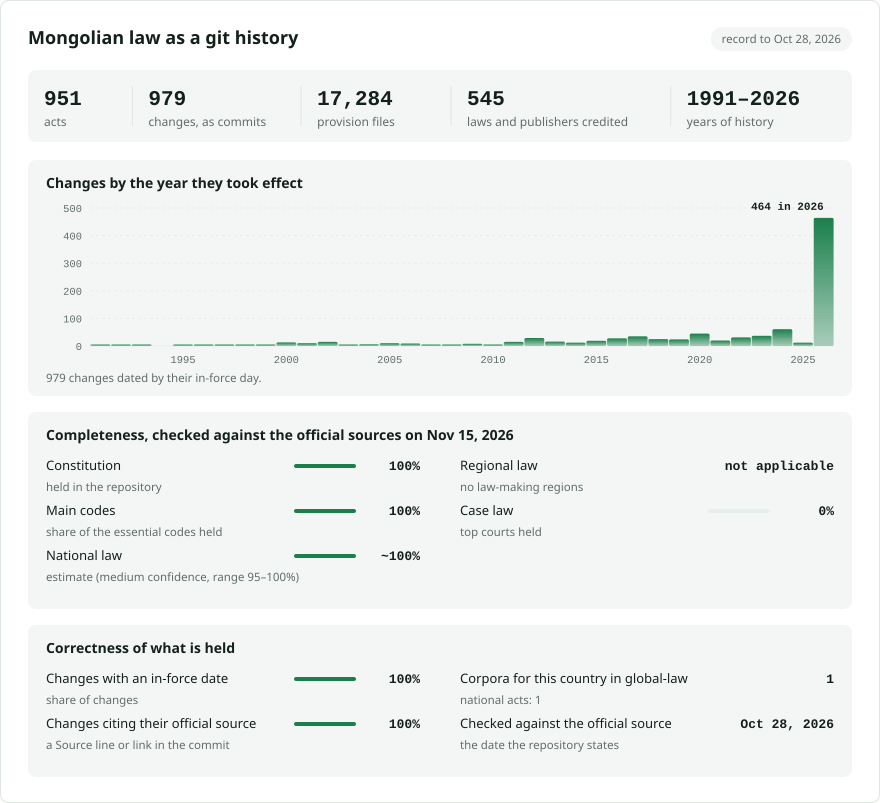

# Mongolia: law history in git

[Монгол](README.md) · **English**

<picture>
<source media="(prefers-color-scheme: dark)" srcset="data/effort-dark.svg">

</picture>

The law of Mongolia as a git history: one file per article, one commit per text, and the law or the publisher behind each text as the commit's author. legalinfo.mn publishes each law's current consolidated text and, for a few laws, the text as adopted, but no dated versions in between: a text as adopted is dated on the day it took effect and credited to the law; a current text is dated on the day it was read, 2026-10-28, and credited to the publisher. `git blame` names the law or the publisher behind every line; `git log` shows what changed between the two texts; picking a date gives the text held for that day, with a warning where the wording in force then is not published.

Part of [lexifina/global-law](https://github.com/lexifina/global-law), one git history for every country's law: this is Mongolia's national law, which global-law reads at `mongolia/national/acts/`.

**What is in it now:** the Constitution and the 951 laws that legalinfo.mn, the Unified Legal Information System, lists as in force, in 16,332 articles, with 979 texts: 544 as adopted (30 that the site publishes as the original text, and 514 laws with no amending act listed, whose current text is taken as the text as adopted) and 435 current texts of amended laws; 27 acts have both. [`laws.csv`](laws.csv) lists every law with its dates and its legalinfo.mn link, by its folder name before the move below.

Each act is in `<kind>/<year>/<legalinfo.mn id>/`, by the year it was adopted, one file per article (`zuil-21.md`; article 19¹ is `zuil-19-1.md`) and the text before the first article in `ehlel.md`: `constitution/1992/367/` is the Constitution (МОНГОЛ УЛСЫН ҮНДСЭН ХУУЛЬ) and `law/2021/16230709635751/` the Labour Law (ХӨДӨЛМӨРИЙН ТУХАЙ, revised 2 July 2021). Until 2026-11-10 the folders were `undsen-khuuli/` and `huuli/<id>/`; [`data/paths.json`](data/paths.json) maps each old name to its folder. `git blame` and `git log --follow` follow a file across that move; `git log` without `--follow` needs the old name for earlier texts; `tools/in_force_on.py` takes either name.

The text is in Mongolian (Cyrillic), as legalinfo.mn publishes it. The site's English texts are not official and are not part of this record.

## Questions as git commands

| Question | Command |
| --- | --- |
| Every change to Article 21 of the Constitution | `git log -p --word-diff --follow -- constitution/1992/367/zuil-21.md` |
| Which act wrote each line of Article 21? | `git blame constitution/1992/367/zuil-21.md` |
| Every text of the Constitution held here, with its date | `git log --diff-filter=AMD --format="%h %(trailers:key=In-force,valueonly,separator=) %an" -- constitution/1992/367 undsen-khuuli` |
| Article 21 as in force on 1 January 1995 | `python tools/in_force_on.py 1995-01-01 constitution/1992/367 zuil-21` |

**Outside git**, we also host this record publicly, for free:

- **[Ask Claude about Mongolian law](https://global-law.lexifina.com/v1/try_claude?country=mongolia)**: opens Claude with a first question ready.
- **[Ask ChatGPT](https://global-law.lexifina.com/v1/try_chatgpt?country=mongolia)**: the same question in ChatGPT.
- **[Search Mongolian law on our site](https://lexifina.com/law?country=mongolia&q=%D1%8D%D1%8D%D0%BB%D0%B6%D0%B8%D0%B9%D0%BD+%D0%B0%D0%BC%D1%80%D0%B0%D0%BB%D1%82)**: a search for "ээлжийн амралт" (annual leave), with each provision's text and its versions, no account needed.
- **[Developer REST API](https://global-law.lexifina.com/v1/search_law?query=%D1%8D%D1%8D%D0%BB%D0%B6%D0%B8%D0%B9%D0%BD+%D0%B0%D0%BC%D1%80%D0%B0%D0%BB%D1%82&jurisdiction=mongolia)**: the same search as JSON, with no key. See the [documentation here](https://lexifina.com/api/global-law).

Both assistants read the record through the free Global law connector (MCP, `https://global-law.lexifina.com/mcp`); the first time, the chat gives you the link that adds it. Ask in Mongolian or in English.

**Host it yourself easily.** All it takes is git and Python, and the tools run on your machine:

```sh
git clone --depth 1 https://github.com/lexifina/global-law && cd global-law
python3 tools/countries.py add mongolia/national/acts
python3 tools/law.py show 2026-11-01 mongolia/national/acts/constitution/1992/367/zuil-21.md
```

Opened in Claude Code, Cursor, VS Code or Codex, the clone also starts a local MCP server with the same tools ([MCP.md](https://github.com/lexifina/global-law/blob/main/MCP.md)).

## Dates

Each commit is dated at noon, Asia/Ulaanbaatar, and carries its day in its `In-force:` trailer:

- for a text as adopted, the law's own in-force date on legalinfo.mn ("дагаж мөрдөх огноо"); where the site gives none, the adoption date, and `Evidence:` says so. The Constitution is in force from 12 February 1992 (its Article 70.2);
- for a current text, the day it was read as in force, 2026-10-28 (`Consolidated:`), not the day it took effect. `Amended-by:` lists each amending act with its adoption date, and `Unknown-from:` gives the first of them, from which the earlier text may no longer be the law;
- ask for a date with `tools/in_force_on.py`, which reads `In-force:` and warns when the wording in force on that day is not published.

A text as adopted is credited to the law itself, by its title and adoption date. A current text is credited to the publisher, Эрх зүйн мэдээллийн нэгдсэн систем (legalinfo.mn), because the site does not say which amending act wrote which words; `git blame` names the publisher on those lines.

## How it is checked

- `tools/build/check_repo.py` reads all 952 acts and 979 texts back from git and compares them word for word with the site's pages: 0 mismatches, and every commit's trailers parse.
- `tools/build/check_letters.py`, which shares no code with the builder, compares the letters and digits of every text with the raw page: 0 mismatches.
- Two builds from the same retrieved pages gave the same history; the sha256 of every retrieved page is in [`data/source-sha256.tsv`](data/source-sha256.tsv) (see [`REPRODUCE.md`](REPRODUCE.md)).
- The layout move of 2026-11-10 renamed folders only; no text changed.
- [vulnerabilities/](vulnerabilities/README.en.md): possible drafting mistakes in Mongolian law, found by global-law's detectors and checked by hand.

## What it does not show

- **The wording between the original and the current text.** legalinfo.mn does not publish it, and the amending acts were not replayed: 408 amended laws have their current text only.
- **Which amending act wrote which words** in a current text. The 3,285 amending acts are in `Amended-by:` and [`data/amending-acts.csv`](data/amending-acts.csv), and the publisher's 22,643 per-provision notes in [`data/amendments.csv`](data/amendments.csv).
- **Which words apply later.** A current text includes provisions not yet applicable, with the publisher's note in the text ("... -ний өдрөөс эхлэн дагаж мөрдөнө", applies from; kind `applies-from` in `data/amendments.csv`).
- **Annexes** (the "Хавсралт" tab, 30 laws); tables in the text are kept, one row per line.
- **Repealed laws**, international treaties, resolutions of the State Great Khural, decrees and regulations.

## Sources

| Source | Kind | Past versions | Notes |
| --- | --- | --- | --- |
| [legalinfo.mn](https://legalinfo.mn) (Хууль зүйн үндэсний хүрээлэн) | Unified Legal Information System (Эрх зүйн мэдээллийн нэгдсэн систем) | no: the current text, and the original text for 30 laws | The list of laws in force with their adoption and in-force dates, each law's page and its amending acts; retrieved 2026-10-28 ([`SOURCES.md`](SOURCES.md)) |

## Licence

See [`LICENSE`](LICENSE). Under Article 7.1.1 of the Law of Mongolia on Copyright (revised, 6 May 2021), laws, administrative normative acts and other legal acts are not protected by copyright. The layout, commit history, data files and tools are Lexifina's and are CC0 1.0.

No AI model wrote, translated or changed legal text, and none runs at fetch or build time; the scripts and documents were written by an AI model (see [`REPRODUCE.md`](REPRODUCE.md)).

## Visualisations

- [visualisations/](visualisations/README.en.md): charts drawn from this repository. Not drawn yet.

## More

From [lexifina/global-law](https://github.com/lexifina/global-law):

- [FEATURES.md](https://github.com/lexifina/global-law/blob/main/FEATURES.md): every feature, and what every corpus must support (`git blame`, `law.py`, the MCP tools)
- [FAQ.md](https://github.com/lexifina/global-law/blob/main/FAQ.md): questions and answers · [CONTRIBUTING.md](https://github.com/lexifina/global-law/blob/main/CONTRIBUTING.md): proposing changes · [MCP.md](https://github.com/lexifina/global-law/blob/main/MCP.md): the MCP server · [REPRODUCE.md](https://github.com/lexifina/global-law/blob/main/REPRODUCE.md): how it was built · [CHANGELOG.md](https://github.com/lexifina/global-law/blob/main/CHANGELOG.md)
- [FRESHNESS.md](https://github.com/lexifina/global-law/blob/main/FRESHNESS.md): how current each corpus is · [Monitoring](https://github.com/lexifina/global-law/tree/main/monitoring): whether updates are running · [WATCHING.md](https://github.com/lexifina/global-law/blob/main/WATCHING.md): how each official source is watched for changes
- [performance/](https://github.com/lexifina/global-law/tree/main/performance): how fast the tools are, measured
- [visualisations/](https://github.com/lexifina/global-law/tree/main/visualisations): charts and bridges across the world's law
- [Vulnerabilities](https://github.com/lexifina/global-law/tree/main/vulnerabilities): mistakes in legislation as published
