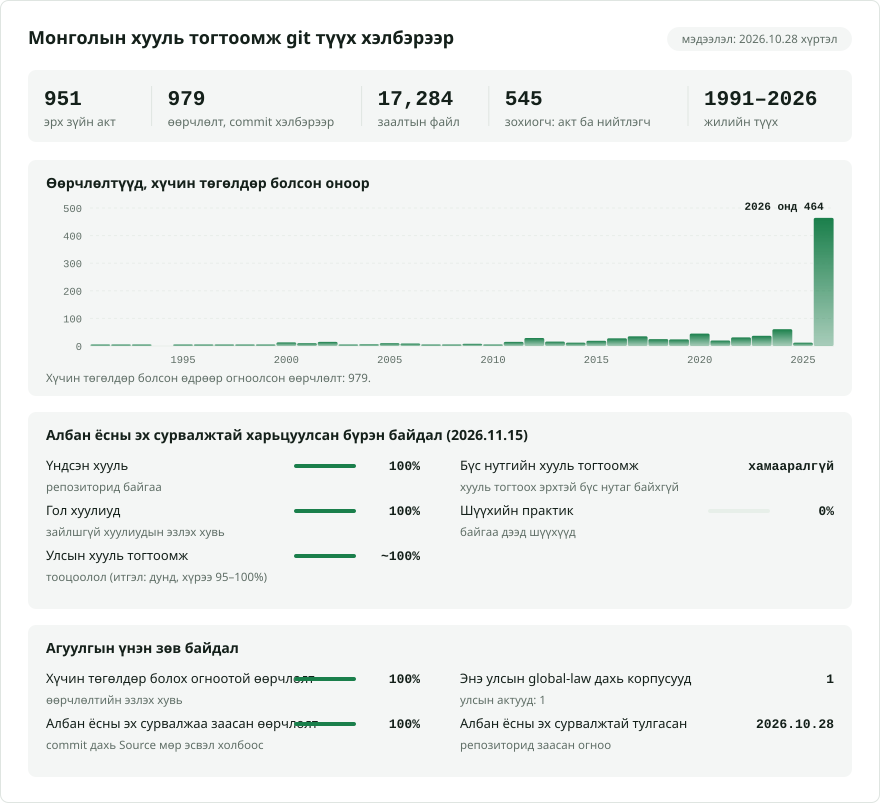

# Монгол Улс: git дахь хууль тогтоомжийн түүх

**Монгол** · [English](README.en.md)

<picture>
<source media="(prefers-color-scheme: dark)" srcset="data/mn/effort-dark.svg">

</picture>

Монгол Улсын хууль тогтоомжийг git-ийн түүх хэлбэрээр: зүйл бүр нэг файл, эх бичвэр бүр нэг коммит, эх бичвэр бүрийн цаана байгаа хууль эсвэл нийтлэгч нь коммитын зохиогч (author). legalinfo.mn нь хууль бүрийн одоогийн нэгтгэсэн эх бичвэрийг, цөөн хэдэн хуулийн хувьд батлагдсан үеийн эх бичвэрийг нийтэлдэг боловч хоорондох огноотой хувилбаруудыг нийтэлдэггүй: батлагдсан үеийн эх бичвэрийг хүчин төгөлдөр болсон өдрөөр нь огноолж, хуульд нь хамааруулна; одоогийн эх бичвэрийг уншсан өдөр болох 2026-10-28-аар огноолж, нийтлэгчид хамааруулна. `git blame` мөр бүрийн цаана байгаа хууль эсвэл нийтлэгчийг заана; `git log` хоёр эх бичвэрийн хооронд юу өөрчлөгдсөнийг харуулна; огноо сонговол тухайн өдөрт хадгалагдсан эх бичвэрийг өгөх ба тэр үед хүчин төгөлдөр байсан найруулга нийтлэгдээгүй бол анхааруулга өгнө.

Энэ нь [lexifina/global-law](https://github.com/lexifina/global-law)-ийн нэг хэсэг бөгөөд бүх улсын хууль тогтоомжийг нэг git түүх болгосон: энд Монгол Улсын үндэсний хууль тогтоомж байгаа бөгөөд global-law үүнийг `mongolia/national/acts/`-аас уншина.

**Одоо юу байгаа вэ:** Үндсэн хууль болон Эрх зүйн мэдээллийн нэгдсэн систем legalinfo.mn-д хүчин төгөлдөр гэж бүртгэгдсэн 951 хууль, нийт 16 332 зүйл, 979 эх бичвэртэй: батлагдсан үеийн 544 эх бичвэр (сайтын анхны эх бичвэр болгон нийтэлсэн 30, мөн нэмэлт, өөрчлөлт оруулсан хууль бүртгэгдээгүй тул одоогийн эх бичвэрийг нь батлагдсан үеийн эх бичвэр гэж үзсэн 514 хууль) болон нэмэлт, өөрчлөлт орсон хуулиудын одоогийн 435 эх бичвэр; 27 акт хоёулаа бий. [`laws.csv`](laws.csv) нь хууль бүрийг огноо болон legalinfo.mn-ийн холбоосын хамт доор дурдсан шилжүүлэлтээс өмнөх хавтасны нэрээр жагсаана.

Акт бүр батлагдсан оноороо `<kind>/<year>/<legalinfo.mn id>/`-д байх ба зүйл бүр нэг файл (`zuil-21.md`; 19¹ дүгээр зүйл нь `zuil-19-1.md`), эхний зүйлээс өмнөх эх бичвэр `ehlel.md`-д байна: `constitution/1992/367/` нь Үндсэн хууль (МОНГОЛ УЛСЫН ҮНДСЭН ХУУЛЬ), `law/2021/16230709635751/` нь Хөдөлмөрийн тухай хууль (ХӨДӨЛМӨРИЙН ТУХАЙ, 2021 оны 7 дугаар сарын 2-ны шинэчилсэн найруулга). 2026-11-10 хүртэл хавтаснууд нь `undsen-khuuli/` болон `huuli/<id>/` байсан; [`data/paths.json`](data/paths.json) хуучин нэр бүрийг хавтастай нь харгалзуулна. `git blame` болон `git log --follow` нь тэр шилжүүлэлтийг дамжин файлыг мөшгинө; `--follow`-гүй `git log` нь өмнөх эх бичвэрүүдэд хуучин нэрийг шаардана; `tools/in_force_on.py` аль ч нэрийг хүлээн авна.

Эх бичвэр нь legalinfo.mn-ийн нийтэлсэн ёсоор монгол хэлээр (кирилл үсгээр) байна. Сайтын англи эх бичвэрүүд албан ёсны биш бөгөөд энэ бүртгэлд ороогүй.

## git тушаалаар хариулах асуултууд

| Асуулт | Тушаал |
| --- | --- |
| Үндсэн хуулийн 21 дүгээр зүйлийн бүх өөрчлөлт | `git log -p --word-diff --follow -- constitution/1992/367/zuil-21.md` |
| 21 дүгээр зүйлийн мөр бүрийг аль акт бичсэн бэ? | `git blame constitution/1992/367/zuil-21.md` |
| Энд хадгалагдсан Үндсэн хуулийн бүх эх бичвэр, огноотой нь | `git log --diff-filter=AMD --format="%h %(trailers:key=In-force,valueonly,separator=) %an" -- constitution/1992/367 undsen-khuuli` |
| 1995 оны 1 дүгээр сарын 1-нд хүчин төгөлдөр байсан 21 дүгээр зүйл | `python tools/in_force_on.py 1995-01-01 constitution/1992/367 zuil-21` |

**git-ээс гадна** бид энэ бүртгэлийг олон нийтэд үнэ төлбөргүй нээлттэй байршуулдаг:

- **[Монголын хууль тогтоомжийн талаар Claude-аас асуух](https://global-law.lexifina.com/v1/try_claude?country=mongolia)**: эхний асуулт бэлэн болсон Claude-ыг нээнэ.
- **[ChatGPT-ээс асуух](https://global-law.lexifina.com/v1/try_chatgpt?country=mongolia)**: ижил асуултыг ChatGPT-д.
- **[Манай сайтаас Монголын хууль тогтоомж хайх](https://lexifina.com/law?country=mongolia&q=%D1%8D%D1%8D%D0%BB%D0%B6%D0%B8%D0%B9%D0%BD+%D0%B0%D0%BC%D1%80%D0%B0%D0%BB%D1%82)**: "ээлжийн амралт" гэсэн хайлт, заалт бүрийн эх бичвэр болон түүний хувилбаруудын хамт, бүртгэл шаардлагагүй.
- **[Хөгжүүлэгчийн REST API](https://global-law.lexifina.com/v1/search_law?query=%D1%8D%D1%8D%D0%BB%D0%B6%D0%B8%D0%B9%D0%BD+%D0%B0%D0%BC%D1%80%D0%B0%D0%BB%D1%82&jurisdiction=mongolia)**: ижил хайлтыг JSON хэлбэрээр, түлхүүргүйгээр. [Баримт бичгийг эндээс](https://lexifina.com/api/global-law) үзнэ үү.

Хоёр туслах хоёулаа энэ бүртгэлийг үнэ төлбөргүй Global law холбогчоор (MCP, `https://global-law.lexifina.com/mcp`) уншина; анх удаа ашиглахад чат түүнийг нэмэх холбоосыг өгнө. Монгол эсвэл англи хэлээр асууж болно.

**Өөрөө хялбархан байршуулах.** Зөвхөн git болон Python хэрэгтэй бөгөөд хэрэгслүүд таны компьютер дээр ажиллана:

```sh
git clone --depth 1 https://github.com/lexifina/global-law && cd global-law
python3 tools/countries.py add mongolia/national/acts
python3 tools/law.py show 2026-11-01 mongolia/national/acts/constitution/1992/367/zuil-21.md
```

Claude Code, Cursor, VS Code эсвэл Codex-д нээхэд энэ клон нь ижил хэрэгслүүдтэй орон нутгийн MCP серверийг мөн эхлүүлнэ ([MCP.md](https://github.com/lexifina/global-law/blob/main/MCP.md)).

## Огноо

Коммит бүрийг үд дунд (Asia/Ulaanbaatar) огноолж, өдрийг нь `In-force:` трейлерт тэмдэглэнэ:

- батлагдсан үеийн эх бичвэрийн хувьд legalinfo.mn дээрх тухайн хуулийн өөрийн хүчин төгөлдөр болох огноо ("дагаж мөрдөх огноо"); сайт үүнийг өгөөгүй бол батлагдсан огноо бөгөөд `Evidence:` үүнийг тэмдэглэнэ. Үндсэн хууль 1992 оны 2 дугаар сарын 12-ноос хүчин төгөлдөр (түүний 70.2 дугаар зүйл);
- одоогийн эх бичвэрийн хувьд хүчин төгөлдөр гэж уншсан өдөр болох 2026-10-28 (`Consolidated:`), хүчин төгөлдөр болсон өдөр биш. `Amended-by:` нэмэлт, өөрчлөлт оруулсан акт бүрийг батлагдсан огноотой нь жагсааж, `Unknown-from:` тэдгээрийн эхнийхийг өгнө; тэр өдрөөс эхлэн өмнөх эх бичвэр хууль байхаа больсон байж болзошгүй;
- огноогоор асуухдаа `tools/in_force_on.py`-г ашиглана уу; энэ нь `In-force:`-ийг уншиж, тухайн өдөр хүчин төгөлдөр байсан найруулга нийтлэгдээгүй бол анхааруулна.

Батлагдсан үеийн эх бичвэрийг нэр, батлагдсан огноогоор нь тухайн хуульд өөрт нь хамааруулна. Одоогийн эх бичвэрийг нийтлэгч болох Эрх зүйн мэдээллийн нэгдсэн систем (legalinfo.mn)-д хамааруулна, учир нь аль нэмэлт, өөрчлөлт оруулсан акт аль үгийг бичсэнийг сайт заадаггүй; эдгээр мөр дээр `git blame` нийтлэгчийг заана.

## Хэрхэн шалгадаг вэ

- `tools/build/check_repo.py` нь 952 акт болон 979 эх бичвэрийг бүгдийг git-ээс буцааж уншиж, сайтын хуудсуудтай үг үгээр нь харьцуулдаг: зөрүү 0, коммит бүрийн трейлер задлагдана.
- Бүтээгчтэй ямар ч код хуваалцдаггүй `tools/build/check_letters.py` нь эх бичвэр бүрийн үсэг, цифрийг түүхий хуудастай харьцуулдаг: зөрүү 0.
- Татаж авсан ижил хуудсуудаас хоёр удаа бүтээхэд ижил түүх гарсан; татаж авсан хуудас бүрийн sha256 нь [`data/source-sha256.tsv`](data/source-sha256.tsv)-д байна ([`REPRODUCE.md`](REPRODUCE.md)-г үзнэ үү).
- 2026-11-10-ны бүтцийн шилжүүлэлт зөвхөн хавтасны нэрийг өөрчилсөн; ямар ч эх бичвэр өөрчлөгдөөгүй.

## Юуг харуулдаггүй вэ

- **Анхны болон одоогийн эх бичвэрийн хоорондох найруулга.** legalinfo.mn үүнийг нийтэлдэггүй бөгөөд нэмэлт, өөрчлөлт оруулсан актуудыг дахин хэрэглээгүй: нэмэлт, өөрчлөлт орсон 408 хуулийн зөвхөн одоогийн эх бичвэр байна.
- Одоогийн эх бичвэрт **аль нэмэлт, өөрчлөлт оруулсан акт аль үгийг бичсэн.** Нэмэлт, өөрчлөлт оруулсан 3 285 акт `Amended-by:` болон [`data/amending-acts.csv`](data/amending-acts.csv)-д, нийтлэгчийн заалт тус бүрийн 22 643 тэмдэглэл [`data/amendments.csv`](data/amendments.csv)-д байна.
- **Аль үгс хожим мөрдөгдөх.** Одоогийн эх бичвэрт хараахан мөрдөгдөөгүй заалтууд нийтлэгчийн тэмдэглэлийн хамт эх бичвэрт орсон байна ("... -ний өдрөөс эхлэн дагаж мөрдөнө"; `data/amendments.csv` дахь төрөл нь `applies-from`).
- **Хавсралтууд** ("Хавсралт" таб, 30 хууль); эх бичвэр доторх хүснэгтүүдийг мөр бүрийг нэг мөрөнд байлгаж хадгалсан.
- **Хүчингүй болсон хуулиуд**, олон улсын гэрээ, Улсын Их Хурлын тогтоол, зарлиг болон журам.

## Эх сурвалж

| Эх сурвалж | Төрөл | Өмнөх хувилбарууд | Тэмдэглэл |
| --- | --- | --- | --- |
| [legalinfo.mn](https://legalinfo.mn) (Хууль зүйн үндэсний хүрээлэн) | Эрх зүйн мэдээллийн нэгдсэн систем | үгүй: одоогийн эх бичвэр, 30 хуулийн хувьд анхны эх бичвэр | Хүчин төгөлдөр хуулиудын жагсаалт батлагдсан болон хүчин төгөлдөр болох огнооны хамт, хууль бүрийн хуудас болон түүнд нэмэлт, өөрчлөлт оруулсан актууд; 2026-10-28-нд татаж авсан ([`SOURCES.md`](SOURCES.md)) |

## Лиценз

[`LICENSE`](LICENSE)-ийг үзнэ үү. Зохиогчийн эрх болон түүнд хамаарах эрхийн тухай Монгол Улсын хуулийн (шинэчилсэн найруулга, 2021 оны 5 дугаар сарын 6) 7.1.1-д зааснаар хууль, захиргааны хэм хэмжээний акт болон бусад эрх зүйн акт зохиогчийн эрхээр хамгаалагдахгүй. Бүтэц, коммитын түүх, өгөгдлийн файлууд болон хэрэгслүүд нь Lexifina-гийнх бөгөөд CC0 1.0 лицензтэй.

Ямар ч хиймэл оюуны загвар хуулийн эх бичвэрийг бичээгүй, орчуулаагүй, өөрчлөөгүй бөгөөд татах эсвэл бүтээх үед ямар ч загвар ажилладаггүй; скрипт болон баримт бичгийг хиймэл оюуны загвар бичсэн ([`REPRODUCE.md`](REPRODUCE.md)-г үзнэ үү).

Энэ текст нь англи хувилбарын ([README.en.md](README.en.md)) орчуулга юм; зөрүүтэй бол англи хувилбарыг баримтална.

## Дэлгэрэнгүй

[lexifina/global-law](https://github.com/lexifina/global-law) репозиториос (англи хэл дээрх хуудсууд):

- [FEATURES.md](https://github.com/lexifina/global-law/blob/main/FEATURES.md): бүх боломж, корпус бүрийн дэмжих ёстой зүйлс (`git blame`, `law.py`, MCP хэрэгслүүд)
- [FAQ.md](https://github.com/lexifina/global-law/blob/main/FAQ.md): асуулт, хариулт · [CONTRIBUTING.md](https://github.com/lexifina/global-law/blob/main/CONTRIBUTING.md): өөрчлөлт санал болгох · [MCP.md](https://github.com/lexifina/global-law/blob/main/MCP.md): MCP сервер · [REPRODUCE.md](https://github.com/lexifina/global-law/blob/main/REPRODUCE.md): хэрхэн бүтээсэн · [CHANGELOG.md](https://github.com/lexifina/global-law/blob/main/CHANGELOG.md)
- [FRESHNESS.md](https://github.com/lexifina/global-law/blob/main/FRESHNESS.md): корпус бүр хэр шинэчлэгдсэн · [Хяналт](https://github.com/lexifina/global-law/tree/main/monitoring): шинэчлэлт ажиллаж байгаа эсэх · [WATCHING.md](https://github.com/lexifina/global-law/blob/main/WATCHING.md): албан ёсны эх сурвалж бүрийн өөрчлөлтийг хэрхэн хянадаг
- [performance/](https://github.com/lexifina/global-law/tree/main/performance): хэрэгслүүдийн хэмжсэн хурд
- [visualisations/](https://github.com/lexifina/global-law/tree/main/visualisations): дэлхийн хууль эрх зүйг хамарсан график ба холбоосууд
- [Сул талууд](https://github.com/lexifina/global-law/tree/main/vulnerabilities): нийтлэгдсэн хэлбэрээрээ хууль тогтоомжид буй алдаа
