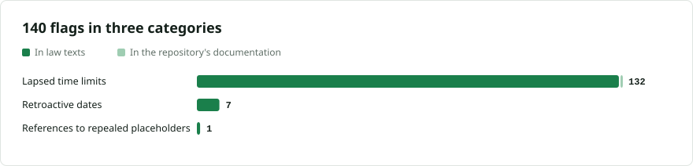

# Vulnerabilities in Mongolian law

[Монгол](README.md) · **English**

<picture>
<source media="(prefers-color-scheme: dark)" srcset="img/flags-by-category-dark.svg">

</picture>

The vulnerability detectors from [lexifina/global-law](https://github.com/lexifina/global-law/tree/main/vulnerabilities) look for mechanical mistakes in legislation: a rule applying "until" a date that has passed, an act in force before it was adopted, a time limit extended only after it had run out, a reference to an article that no longer exists. global-law's published list (9 November 2026) covered Mongolia from an earlier commit of this repository and raised seven flags, all retroactive dates: the same seven acts this run flags. This is a run over this repository only, as it stood at commit [`37edd99`](https://github.com/lexifina/mongolia-law/commit/37edd993702a1152362719416963f1dec4581557) on 16 November 2026: the Constitution and 951 laws that legalinfo.mn lists as in force, in 979 texts (544 as adopted, 435 current).

**In short:** the detectors raised 140 flags. A language model reviewed 56 of the strongest, arguing each one for and against; 2 survived. Checked by hand in this repository, neither is a drafting mistake: each is a law whose own last article makes it apply from a day before it was adopted. The Law on exemption from value added tax of 4 February 2016 applies from 1 January 2015, so that the exemption for electricity imported by the Western Region Energy System, which a law of 9 December 2011 granted until 1 January 2015, ran on without a break; the Law on exemption from customs duty of 16 February 2012, for the equipment of the automated election system, applies from 1 February 2012. The hand check also found that this repository dates the law of 29 May 2015 repealing the Law on the procedure for drafting and submitting laws on 10 February 2015, before it was adopted, although the law itself takes effect with the revised Law on Legislation; that four articles of the Criminal Code of 2002 carry the number of the next article in their heading, so that article 190 is filed as `zuil-191.md`. One reference, in the Criminal Code of 1986, to an article repealed in 1995 is left open. Later, this will be formalised in Lean, similar to our work on [the US tax code](https://lexifina.com/blog/formalizing-the-us-tax-code) and [US case law](https://lexifina.com/blog/formalizing-all-us-case-law-in-lean).

A flag is a prompt to look, not legal advice, and nothing here has been tested in court.

## Flags by category

| Category | What it looks for | Flags | In law texts | Reviewed | Survived review |
| --- | --- | ---: | ---: | ---: | ---: |
| Lapsed time limits | Text still applying a rule "until" a date that has passed | 132 | 131 | 49 | 0 |
| Retroactive or pre-publication dates | An act in force before it was adopted or published | 7 | 7 | 7 | 2 |
| References to repealed placeholders | A provision citing an article that now reads only as repealed | 1 | 1 | 0 | 0 |

"In law texts" counts all the law this repository holds: the Constitution and the laws. The other flag is in this repository's English README. legalinfo.mn publishes each law's current text and, for some laws, the text as adopted, with no dated versions in between, so this repository holds one commit per text: 544 laws as adopted (514 of them because the site lists no act amending them, so their current text is taken as the text as adopted) and 435 amended laws as they read on 28 October 2026, credited to the publisher. So the search for repeal gaps, same-day conflicts, empty periods, stale amounts and references to deleted provisions found nothing to compare; the current texts are not counted as changes to the law, since no day of any change is known for them. Nor did the search for dead currencies (amounts are in tögrög), for duplicate numbering (each article is its own file) or for publisher notes find anything. The search for lapsed time limits reads "хүртэл" (until) and "дуустал" (until it ends) after a date written as Mongolian law writes it ("2020 оны 12 дугаар сарын 31-ний өдрийг хүртэл") since a fix for this repository: all 191 such dates in the law texts, and "2000 он дуустал" (until the end of 2000) twice. It leaves out 5 places where "хүртэл" follows a year alone ("2030 он хүртэл"), only one of them in the past.

*Edge cases: the 2 flags that survived the review, grouped by what they turned out to be, and what the other flags are, in [EDGE-CASES.en.md](EDGE-CASES.en.md).*

## Problems found in this repository

- **A date before adoption:** the Law of 29 May 2015 repealing the Law on the procedure for drafting and submitting laws and other decisions of the State Great Khural ([`law/2015/11120`](https://github.com/lexifina/mongolia-law/tree/37edd993702a1152362719416963f1dec4581557/law/2015/11120)) is dated 10 February 2015, the in-force day legalinfo.mn gives, which is before the law was adopted. Its [Article 2](https://github.com/lexifina/mongolia-law/blob/37edd993702a1152362719416963f1dec4581557/law/2015/11120/zuil-2.md) says it applies from the day the Law on Legislation (revised) takes effect. legalinfo.mn gives that law, adopted the same day ([`law/2015/11119`](https://github.com/lexifina/mongolia-law/tree/37edd993702a1152362719416963f1dec4581557/law/2015/11119)), the in-force day 10 February 2016, and its [Article 53.1](https://github.com/lexifina/mongolia-law/blob/37edd993702a1152362719416963f1dec4581557/law/2015/11119/zuil-53.md), as amended by a law of 4 February 2016, now says 1 January 2017. The site's day for the repealing law looks a year off; the repository takes it as given ([the commit](https://github.com/lexifina/mongolia-law/commit/8b5b511ea535aca96fbd5bd1b07f92224162ba6f)).
- **Article headings with the wrong number:** in the Criminal Code of 3 January 2002 ([`law/2002/12172`](https://github.com/lexifina/mongolia-law/tree/37edd993702a1152362719416963f1dec4581557/law/2002/12172)), as legalinfo.mn publishes it, articles 190, 220, 250 and 260 are headed "191", "221", "251" and "261" while their parts are numbered 190.1, 220.1, 250.1 and 260.1. This repository names each article's file by its heading, so [`zuil-191.md`](https://github.com/lexifina/mongolia-law/blob/37edd993702a1152362719416963f1dec4581557/law/2002/12172/zuil-191.md) holds article 190 (breach of the rules on explosive and radioactive substances) and [`zuil-191~2.md`](https://github.com/lexifina/mongolia-law/blob/37edd993702a1152362719416963f1dec4581557/law/2002/12172/zuil-191~2.md) article 191; there is no `zuil-190.md`, `zuil-220.md`, `zuil-250.md` or `zuil-260.md`.

## Files

| File | What it holds |
| --- | --- |
| [data/flags.csv](data/flags.csv) | Every flag, one row per article or act and issue |
| [data/reviewed.csv](data/reviewed.csv) | The 56 flags the model reviewed, with its verdict and reason |
| [data/by_category.csv](data/by_category.csv) | The counts in the table above |
| [tools/](tools/) | The scripts that made this run |

Columns: `category` and `category_mn` (the category in English and Mongolian), `detector`, `kind` (`law` or `other`), `path` (the file in this repository; for retroactive dates, the first file of the act), `date` (the date the flag turns on), `reference` (the act or line involved), `summary`, `score` (the detector's ranking, 0 to 1), `review` (`artefact`, `lawful` or `candidate_defect`), `survives_rebuttal`, `review_note` (the model's reason, in English), `url` (the article at the commit that was read, or, for retroactive dates, the act's commit).

## How it was made

- **Detectors:** global-law's [vulnerabilities/scripts](https://github.com/lexifina/global-law/tree/main/vulnerabilities/scripts), with the fixes in [tools/patch_detectors.py](tools/patch_detectors.py) and the other patches in [tools/](tools/README.md), run on this repository at commit `37edd99`. The history table the detectors read was built from this repository's own commits (the act that made each change, and the `In-force` and `Kind` trailers), counting as law the 544 texts as adopted (`Kind: original`); the 435 current texts (`Kind: consolidated`) and the 2 documentation commits are left out. Paths from before the folder move of 10 November 2026 are mapped to each act's folder today through `data/paths.json`. Fixes made for this repository ([tools/](tools/README.md)): each act is told apart by its commit's author, which adds the day of adoption to the title, since several acts share a title (retroactive dates went from 4 mixed flags to 7); the search for time limits reads Mongolian dates (132 flags, from 1); the reference scan reads the article files of this repository (`zuil-21.md`, `zuil-19-1.md`) and "энэ хуулийн 7 дугаар зүйл", and takes only "энэ хуулийн" (this law) for the act's own; and the search for references to repealed articles reads "хүчингүй болсонд тооцсон" (deemed repealed).
- **Model review:** gpt-5.4-mini, the 40 strongest flags per category, and for lapsed time limits also the 40 strongest in law texts (49 lapsed time limits in all); one pass says whether a flag is real, a second argues that it is not. Where a flag was reviewed twice, the later review is kept. There were no empty periods to review, and the model does not review references to repealed placeholders. global-law's own list used a different model.
- **Hand check:** every case that survived was read in this repository's texts and commits, with the laws before and after it where the repository holds them; none is left open. The other flags were read by category. Whether the law of 11 December 1995 that repealed Article 59 of the Criminal Code of 1986 also changed the article that cites it needs that law, which this repository does not hold; the in-force day legalinfo.mn gives the Law on exemption from customs duty of 7 December 2000 (13 August 2000) needs an official source.

To report a correction, open an issue with the provision and an official source.

## Licence

The lists and notes are Lexifina's, dedicated to the public domain under CC0 1.0, like the rest of this repository's own contributions. Quoted law text is as the Unified Legal Information System, legalinfo.mn (Хууль зүйн үндэсний хүрээлэн), publishes it; laws, administrative normative acts and other legal acts are not protected by copyright in Mongolia (Law on Copyright and Related Rights, revised 6 May 2021, Article 7.1.1). See [LICENSE](../LICENSE).
