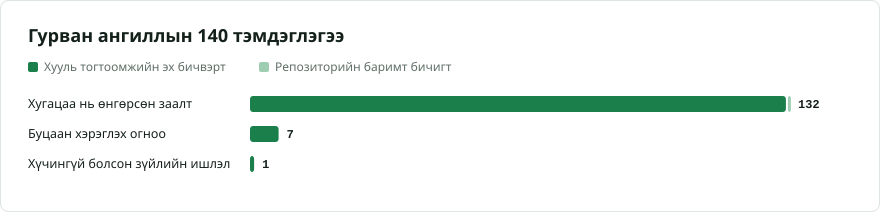

# Монголын хууль тогтоомж дахь сул талууд

**Монгол** · [English](README.en.md)

<picture>
<source media="(prefers-color-scheme: dark)" srcset="img/flags-by-category-dark.mn.svg">

</picture>

[lexifina/global-law](https://github.com/lexifina/global-law/tree/main/vulnerabilities) репозиторийн сул тал илрүүлэгчид хууль тогтоомжоос механик алдаа хайдаг: өнгөрсөн огноог "хүртэл" үйлчлэх заалт, батлагдахаасаа өмнө хүчин төгөлдөр болсон акт, хугацаа нь дууссаны дараа сунгасан хугацаа, байхгүй болсон зүйлийг иш татсан заалт. global-law-ийн нийтэлсэн жагсаалт (2026 оны 11 дүгээр сарын 9) Монголыг энэ репозиторийн өмнөх коммитоос хамруулж, долоон тэмдэглэгээ гаргасан бөгөөд бүгд буцаан хэрэглэх огноо байсан: энэ удаагийн шалгалтын тэмдэглэсэн долоон хууль мөн. Энэ бол зөвхөн энэ репозиторийг, 2026 оны 11 дүгээр сарын 16-ны өдрийн [`37edd99`](https://github.com/lexifina/mongolia-law/commit/37edd993702a1152362719416963f1dec4581557) коммитын байдлаар шалгасан үр дүн: Үндсэн хууль болон legalinfo.mn-д хүчин төгөлдөр гэж бүртгэгдсэн 951 хууль, 979 эх бичвэр (батлагдсан үеийн 544, одоогийн 435).

**Товчхондоо:** илрүүлэгчид 140 тэмдэглэгээ гаргасан. Хэлний загвар хамгийн хүчтэй 56-г нь тус бүрийг дэмжих болон няцаах үндэслэлээр хянаж үзэхэд 2 нь хяналтыг давсан. Энэ репозиторид гараар шалгахад аль нь ч хууль боловсруулалтын алдаа биш: хоёулаа батлагдсан өдрөөсөө өмнөх өдрөөс эхлэн дагаж мөрдөхийг өөрийн сүүлийн зүйлдээ заасан хууль юм. 2016 оны 2 дугаар сарын 4-ний өдрийн Нэмэгдсэн өртгийн албан татвараас чөлөөлөх тухай хуулийг 2015 оны 1 дүгээр сарын 1-ний өдрөөс эхлэн дагаж мөрдөх бөгөөд ингэснээр "Баруун бүсийн эрчим хүчний систем"-ийн импортолж буй цахилгаан эрчим хүчийг 2011 оны 12 дугаар сарын 9-ний өдрийн хуулиар 2015 оны 1 дүгээр сарын 1-ний өдрийг хүртэл чөлөөлсөн хугацаа тасралтгүй үргэлжилсэн; сонгуулийн автоматжуулсан системийн тоног төхөөрөмжид зориулсан 2012 оны 2 дугаар сарын 16-ны өдрийн Гаалийн албан татвараас чөлөөлөх тухай хуулийг 2012 оны 2 дугаар сарын 1-ний өдрөөс эхлэн дагаж мөрдөнө. Гараар шалгахад мөн дараах зүйл илэрсэн: Хууль, Улсын Их Хурлын бусад шийдвэрийн төсөл боловсруулах, өргөн мэдүүлэх журмын тухай хуулийг хүчингүй болсонд тооцох тухай 2015 оны 5 дугаар сарын 29-ний өдрийн хуулийг энэ репозитори батлагдахаас нь өмнөх 2015 оны 2 дугаар сарын 10-ны өдрөөр огноолсон, гэтэл уг хууль өөрөө Хууль тогтоомжийн тухай хууль (шинэчилсэн найруулга) хүчин төгөлдөр болсон өдрөөс эхлэн дагаж мөрдөгдөх ёстой; 2002 оны Эрүүгийн хуулийн дөрвөн зүйлийн гарчигт дараагийн зүйлийн дугаар бичигдсэн тул 190 дүгээр зүйл `zuil-191.md` файлд байна. 1986 оны Эрүүгийн хуулийн, 1995 онд хүчингүй болсон зүйлийг иш татсан нэг заалтын асуудлыг нээлттэй үлдээв. Цаашид үүнийг [АНУ-ын татварын хууль](https://lexifina.com/blog/formalizing-the-us-tax-code) болон [АНУ-ын шүүхийн практик](https://lexifina.com/blog/formalizing-all-us-case-law-in-lean)-ийн адил Lean хэл дээр албан ёсны хэлбэрт оруулна.

Тэмдэглэгээ нь анхаарал хандуулах дохио бөгөөд хуулийн зөвлөгөө биш; энд байгаа зүйлсийг шүүхээр шалгаагүй.

## Ангиллаар нь тэмдэглэгээ

| Ангилал | Юуг хайдаг вэ | Тэмдэглэгээ | Хууль тогтоомжийн эх бичвэрт | Хянасан | Хяналтыг давсан |
| --- | --- | ---: | ---: | ---: | ---: |
| Хугацаа нь өнгөрсөн заалт | Өнгөрсөн огноог "хүртэл" үйлчилсээр буй заалт | 132 | 131 | 49 | 0 |
| Буцаан хэрэглэх болон нийтлэгдэхээс өмнөх огноо | Батлагдах буюу нийтлэгдэхээсээ өмнө хүчин төгөлдөр болсон акт | 7 | 7 | 7 | 2 |
| Хүчингүй болсон зүйлийн ишлэл | Одоо зөвхөн хүчингүй болсон тухай тэмдэглэлтэй үлдсэн зүйлийг иш татсан заалт | 1 | 1 | 0 | 0 |

"Хууль тогтоомжийн эх бичвэрт" гэдэгт энэ репозиторийн агуулж буй бүх хууль тогтоомж, тухайлбал Үндсэн хууль болон хуулиуд орно. Үлдсэн нэг тэмдэглэгээ нь энэ репозиторийн англи README-д байна. legalinfo.mn нь хууль бүрийн одоогийн эх бичвэрийг, зарим хуулийн хувьд батлагдсан үеийн эх бичвэрийг нийтэлдэг бөгөөд хоорондох огноотой хувилбарыг нийтэлдэггүй тул энэ репозитори эх бичвэр бүрийг нэг коммитоор хадгална: батлагдсан үеийн 544 хууль (үүнээс 514 нь сайтад нэмэлт, өөрчлөлт оруулсан акт бүртгэгдээгүй тул одоогийн эх бичвэрийг нь батлагдсан үеийн эх бичвэр гэж үзсэн) болон нэмэлт, өөрчлөлт орсон 435 хуулийн 2026 оны 10 дугаар сарын 28-ны өдрийн байдлаарх, нийтлэгчид хамааруулсан эх бичвэр. Иймд хүчингүй болгосны дараах орон зай, нэг өдөр орсон өөрчлөлт, хоосон хугацаа, хуучирсан дүн, хассан заалтын ишлэлийг хайхад харьцуулах зүйл олдсонгүй; аль нэг өөрчлөлтийн өдөр тодорхойгүй тул одоогийн эх бичвэрийг хууль тогтоомжийн өөрчлөлт гэж тооцоогүй. Гүйлгээнээс гарсан мөнгөн тэмдэгт (дүнг төгрөгөөр заасан), давхардсан дугаарлалт (зүйл бүр тусдаа файлд байна), нийтлэгчийн тэмдэглэлийг хайхад ч мөн юу ч олдсонгүй. Энэ репозиторид зориулсан засвараас хойш хугацаа нь өнгөрсөн заалтын хайлт нь Монголын хууль тогтоомжид бичдэг хэлбэрээр ("2020 оны 12 дугаар сарын 31-ний өдрийг хүртэл") бичсэн огнооны дараах "хүртэл", "дуустал" гэсэн үгийг уншдаг: хууль тогтоомжийн эх бичвэр дэх ийм 191 огноог бүгдийг нь, мөн "2000 он дуустал" гэснийг хоёр удаа. Зөвхөн оны дараа "хүртэл" гэж бичсэн ("2030 он хүртэл") 5 газрыг орхисон бөгөөд тэдгээрийн зөвхөн нэг нь өнгөрсөн онд хамаарна.

*Онцгой тохиолдлууд: хяналтыг давсан 2 тэмдэглэгээг юу болох нь тогтоогдсоноор нь ангилж, бусад тэмдэглэгээ юу болохыг [EDGE-CASES.md](EDGE-CASES.md)-д тайлбарлав.*

## Энэ репозиторид илэрсэн асуудал

- **Батлагдахаас өмнөх огноо:** Хууль, Улсын Их Хурлын бусад шийдвэрийн төсөл боловсруулах, өргөн мэдүүлэх журмын тухай хуулийг хүчингүй болсонд тооцох тухай 2015 оны 5 дугаар сарын 29-ний өдрийн хуулийг ([`law/2015/11120`](https://github.com/lexifina/mongolia-law/tree/37edd993702a1152362719416963f1dec4581557/law/2015/11120)) legalinfo.mn-ийн өгсөн хүчин төгөлдөр болох өдөр буюу 2015 оны 2 дугаар сарын 10-ны өдрөөр огноолсон нь уг хууль батлагдахаас өмнөх өдөр юм. Түүний [2 дугаар зүйл](https://github.com/lexifina/mongolia-law/blob/37edd993702a1152362719416963f1dec4581557/law/2015/11120/zuil-2.md)-д уг хуулийг Хууль тогтоомжийн тухай хууль (шинэчилсэн найруулга) хүчин төгөлдөр болсон өдрөөс эхлэн дагаж мөрдөнө гэжээ. Мөн өдөр батлагдсан тэр хуульд ([`law/2015/11119`](https://github.com/lexifina/mongolia-law/tree/37edd993702a1152362719416963f1dec4581557/law/2015/11119)) legalinfo.mn хүчин төгөлдөр болох өдрийг 2016 оны 2 дугаар сарын 10 гэж өгсөн бөгөөд 2016 оны 2 дугаар сарын 4-ний өдрийн хуулиар өөрчлөлт оруулсан түүний [53.1](https://github.com/lexifina/mongolia-law/blob/37edd993702a1152362719416963f1dec4581557/law/2015/11119/zuil-53.md)-д одоо 2017 оны 1 дүгээр сарын 1-ний өдрөөс эхлэн дагаж мөрдөнө гэж заасан. Хүчингүй болгосон хуулийн хувьд сайтын өгсөн өдөр нэг жилээр зөрсөн бололтой; репозитори түүнийг байгаагаар нь авсан ([коммит](https://github.com/lexifina/mongolia-law/commit/8b5b511ea535aca96fbd5bd1b07f92224162ba6f)).
- **Гарчигтаа буруу дугаартай зүйлүүд:** legalinfo.mn-ийн нийтэлсэн 2002 оны 1 дүгээр сарын 3-ны өдрийн Эрүүгийн хуульд ([`law/2002/12172`](https://github.com/lexifina/mongolia-law/tree/37edd993702a1152362719416963f1dec4581557/law/2002/12172)) 190, 220, 250, 260 дугаар зүйлийн гарчигт "191", "221", "251", "261" гэж бичсэн, харин хэсгүүдийг нь 190.1, 220.1, 250.1, 260.1 гэж дугаарласан. Энэ репозитори зүйл бүрийн файлыг гарчгийнх нь дагуу нэрлэдэг тул [`zuil-191.md`](https://github.com/lexifina/mongolia-law/blob/37edd993702a1152362719416963f1dec4581557/law/2002/12172/zuil-191.md)-д 190 дүгээр зүйл (тэсэрч дэлбэрэх болон цацраг идэвхт бодисыг бүртгэх, хадгалах, ашиглах, тээвэрлэх, илгээх журам зөрчих), [`zuil-191~2.md`](https://github.com/lexifina/mongolia-law/blob/37edd993702a1152362719416963f1dec4581557/law/2002/12172/zuil-191~2.md)-д 191 дүгээр зүйл байна; `zuil-190.md`, `zuil-220.md`, `zuil-250.md`, `zuil-260.md` гэсэн файл байхгүй.

## Файлууд

| Файл | Юуг агуулдаг вэ |
| --- | --- |
| [data/flags.csv](data/flags.csv) | Бүх тэмдэглэгээ, зүйл буюу акт, асуудал тус бүрээр нэг мөр |
| [data/reviewed.csv](data/reviewed.csv) | Загварын хянасан 56 тэмдэглэгээ, түүний дүгнэлт, үндэслэлийн хамт |
| [data/by_category.csv](data/by_category.csv) | Дээрх хүснэгтийн тоонууд |
| [tools/](tools/) | Энэ шалгалтыг хийсэн скриптүүд |

Баганууд: `category` болон `category_mn` (ангилал англи, монгол хэлээр), `detector`, `kind` (`law` эсвэл `other`), `path` (энэ репозитори дахь файл; буцаан хэрэглэх огнооны хувьд тухайн актын эхний файл), `date` (тэмдэглэгээний хамаарах огноо), `reference` (холбогдох акт буюу мөр), `summary`, `score` (илрүүлэгчийн эрэмбэ, 0-ээс 1), `review` (`artefact`, `lawful` эсвэл `candidate_defect`), `survives_rebuttal`, `review_note` (загварын үндэслэл, англи хэлээр), `url` (уншсан коммит дахь зүйл, буцаан хэрэглэх огнооны хувьд тухайн актын коммит).

## Хэрхэн хийсэн бэ

- **Илрүүлэгчид:** global-law-ийн [vulnerabilities/scripts](https://github.com/lexifina/global-law/tree/main/vulnerabilities/scripts)-ийг [tools/patch_detectors.py](tools/patch_detectors.py) дахь засвар болон [tools/](tools/README.md) дахь бусад засварын хамт энэ репозиторийн `37edd99` коммит дээр ажиллуулсан. Илрүүлэгчдийн уншдаг түүхийн хүснэгтийг энэ репозиторийн өөрийн коммитуудаас (өөрчлөлт бүрийг хийсэн акт, `In-force` болон `Kind` трейлер) бүтээж, батлагдсан үеийн 544 эх бичвэрийг (`Kind: original`) хууль тогтоомж гэж тооцсон; одоогийн 435 эх бичвэр (`Kind: consolidated`) болон баримт бичгийн 2 коммитыг оруулаагүй. 2026 оны 11 дүгээр сарын 10-ны өдрийн хавтасны шилжүүлэлтээс өмнөх замыг `data/paths.json`-оор дамжуулан актын өнөөгийн хавтастай харгалзуулсан. Энэ репозиторид зориулж хийсэн засвар ([tools/](tools/README.md)): хэд хэдэн акт ижил нэртэй тул актыг коммитын зохиогчоор нь ялгадаг болсон, зохиогч нь нэрэн дээр батлагдсан өдрийг нэмж бичдэг (буцаан хэрэглэх огноо хольцтой 4 тэмдэглэгээнээс 7 болсон); хугацааны хайлт монгол огноог уншдаг болсон (1-ээс 132 тэмдэглэгээ); ишлэлийн хайлт энэ репозиторийн зүйлийн файлуудыг (`zuil-21.md`, `zuil-19-1.md`) болон "энэ хуулийн 7 дугаар зүйл" гэснийг уншиж, зөвхөн "энэ хуулийн" гэснийг тухайн актын өөрийн ишлэл гэж үздэг болсон; хүчингүй болсон зүйлийн ишлэлийн хайлт "хүчингүй болсонд тооцсон" гэснийг уншдаг болсон.
- **Загварын хяналт:** gpt-5.4-mini, ангилал бүрийн хамгийн хүчтэй 40 тэмдэглэгээ, хугацаа нь өнгөрсөн заалтын хувьд мөн хууль тогтоомжийн эх бичвэр дэх хамгийн хүчтэй 40 (нийт 49); эхний шат нь тэмдэглэгээ бодитой эсэхийг дүгнэж, хоёр дахь шат нь бодит биш гэж няцааж үзнэ. Нэг тэмдэглэгээг хоёр удаа хянасан бол сүүлийн дүгнэлтийг авсан. Хянах хоосон хугацаа байгаагүй бөгөөд загвар хүчингүй болсон зүйлийн ишлэлийг хянадаггүй. global-law-ийн өөрийн жагсаалтад өөр загвар ашигласан.
- **Гараар шалгасан нь:** хяналтыг давсан тохиолдол бүрийг энэ репозиторийн эх бичвэр, коммитуудаас, мөн репозиторид байгаа бол өмнөх болон дараах хуулиудын хамт уншсан; нээлттэй үлдсэн нь байхгүй. Бусад тэмдэглэгээг ангиллаар нь уншсан. 1986 оны Эрүүгийн хуулийн 59 дүгээр зүйлийг хүчингүй болгосон 1995 оны 12 дугаар сарын 11-ний өдрийн хууль түүнийг иш татсан зүйлд мөн өөрчлөлт оруулсан эсэхийг тогтоохын тулд тэр хууль хэрэгтэй, гэтэл энэ репозиторид байхгүй; 2000 оны 12 дугаар сарын 7-ны өдрийн Гаалийн албан татвараас чөлөөлөх тухай хуульд legalinfo.mn-ийн өгсөн хүчин төгөлдөр болох өдрийг (2000 оны 8 дугаар сарын 13) албан ёсны эх сурвалжаар шалгах шаардлагатай.

Залруулга мэдээлэх бол тухайн заалт болон албан ёсны эх сурвалжийг заан issue нээнэ үү.

## Лиценз

Жагсаалт болон тэмдэглэлүүд нь Lexifina-гийнх бөгөөд энэ репозиторийн бусад өөрийн хувь нэмрийн адил CC0 1.0 лицензээр нийтийн өмчид шилжүүлсэн. Иш татсан хуулийн эх бичвэрийг Эрх зүйн мэдээллийн нэгдсэн систем legalinfo.mn (Хууль зүйн үндэсний хүрээлэн)-ийн нийтэлсэн ёсоор авсан; Зохиогчийн эрх болон түүнд хамаарах эрхийн тухай Монгол Улсын хуулийн (шинэчилсэн найруулга, 2021 оны 5 дугаар сарын 6) 7.1.1-д зааснаар хууль, захиргааны хэм хэмжээний акт болон бусад эрх зүйн акт зохиогчийн эрхээр хамгаалагдахгүй. [LICENSE](../LICENSE)-ийг үзнэ үү.
